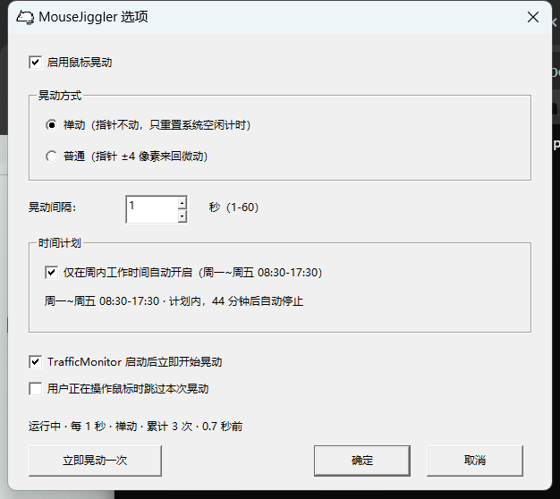

# MouseJiggler — TrafficMonitor 插件 / plugin for TrafficMonitor

[TrafficMonitor](https://github.com/zhongyang219/TrafficMonitor) 的插件：定时晃一下鼠标，
让系统一直处于"有人操作"的状态（避免锁屏、休眠，或 IM 里变成"离开"）。

A TrafficMonitor plugin that periodically injects a mouse movement so that Windows
never sees the machine as idle. Two modes, configurable interval, optional
"work hours only" schedule (Mon–Fri, configurable window).



## 功能

- **两种晃动方式**
  - 禅动（默认）：发送位移为 0 的移动事件，指针**不会动**，但系统空闲计时被重置
  - 普通：指针 ±4 像素来回微动，肉眼可见
- **可调间隔** 1–60 秒（默认 1 秒）
- **时间计划**（可关）：只在**周一~周五 08:30–17:30** 生效，窗口外自动停、进入窗口自动起。
  窗口参数可在 ini 里改（见下）。
- **可选**：用户正在操作鼠标时跳过本次晃动
- 无独立窗口、无托盘图标，全部设置都在 TrafficMonitor 里

## 安装

1. 从 [Releases](../../releases) 下载 `MouseJiggler.dll`（x64）
2. 放进 TrafficMonitor 目录下的 `plugins\` 文件夹
3. 重启 TrafficMonitor
4. `选项 → 常规设置 → 插件管理` 里能看到 `MouseJiggler`，状态为"加载成功"

> 插件位数必须和 TrafficMonitor 一致（64 位 TrafficMonitor 用 64 位插件）。

## 使用

- 设置：`插件管理 → 选中 MouseJiggler → 选项`
- 快捷命令（同一处的右键菜单里）：`启用鼠标晃动` / `禅动模式` / `立即晃动一次`
- 想在任务栏上看到状态：`任务栏右键 → 显示设置` 里勾选 `MouseJiggler`，
  会显示 `晃动 开 / 关 / 计划外`

## 配置

配置文件在 TrafficMonitor 的配置目录下：`plugins\MouseJiggler.ini`

```ini
[general]
enable=1                 ; 用户是否希望晃动
zen=1                    ; 1=禅动（指针不动），0=普通（±4 像素）
interval=1               ; 晃动间隔，1-60 秒
start_on_load=1          ; TrafficMonitor 启动后立即开始
skip_when_user_active=0  ; 1=用户正在操作鼠标时跳过本次

[schedule]
enabled=1                ; 是否只在工作时间生效
weekdays_only=1          ; 1=仅周一~周五
start_min=510            ; 08:30（从 0 点起的分钟数）
duration_min=540         ; 持续 9 小时 -> 17:30
```

`[schedule]` 段不在界面上暴露，需要时直接改 ini，重启 TrafficMonitor 生效。

## 编译

需要 Visual Studio 2022（MSVC v143）和 Windows SDK：

```powershell
.\build.ps1                 # 生成 bin\Release\MouseJiggler.dll
.\build.ps1 -Deploy         # 编译并复制到正在运行的 TrafficMonitor 的 plugins 目录
.\build.ps1 -Deploy -TrafficMonitorDir "C:\Program Files\TrafficMonitor"
```

插件用 `/MT` 静态链接 CRT，不依赖 VC++ 运行库；输出为纯 Win32 DLL，
导出唯一的 `TMPluginGetInstance` 入口。

### 调试/自测工具

```powershell
# 加载 dll 并打印接口信息、跑几个 Tick（不需要 TrafficMonitor）
cl /nologo /EHsc /utf-8 /std:c++17 /I src tools\harness.cpp /Fe:bin\harness.exe user32.lib
.\bin\harness.exe

# 单独打开选项对话框并截图
cl /nologo /EHsc /utf-8 /std:c++17 /I src tools\uipreview.cpp /Fe:bin\uipreview.exe user32.lib
powershell -NoProfile -ExecutionPolicy Bypass -File tools\capture-ui.ps1
```

## 实现要点

- 晃动走独立工作线程（200ms 节拍），不依赖 `ITMPlugin::DataRequired` 的调用频率
  （后者由 TrafficMonitor 的 `monitor_time_span` 决定，用户可能改成 5 秒）
- 禅动模式用 `dx=dy=0` 的 `MOUSEEVENTF_MOVE`：实测能重置 `GetLastInputInfo` 的空闲计时，
  指针不动
- 时间窗口用"起点 + 时长"描述，判定是当前时刻的无状态判断，睡眠唤醒/改时钟/重启都不会错乱
- 配置目录取自 `ITrafficMonitor::GetPluginConfigDir()`，不硬编码路径
- 源码必须用 `/utf-8` 编译（vcxproj 里已设置）

## English

A native x64 TrafficMonitor plugin (C++ / Win32, no MFC) that periodically jiggles the
mouse cursor to keep the session active. Two modes: **zen** (zero-delta movement, the
pointer stays still but the system idle timer is reset) and **normal** (±4 px visible
jiggle). Configurable 1–60 s interval, optional work-hours schedule
(Mon–Fri 08:30–17:30 by default, editable in the ini file).

Install: drop `MouseJiggler.dll` into `plugins\` next to `TrafficMonitor.exe` and restart
it. Settings live under `Options → General Settings → Plugin Manager → MouseJiggler → Options`.

Build with Visual Studio 2022 (`build.ps1`). MIT licensed.
